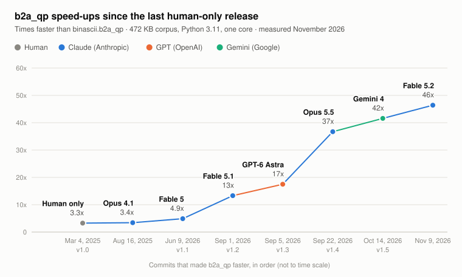

# LLM contributions to zoomascii

Version 1.0 (March 2025) was the last release written entirely by
hand.  At that point `b2a_qp` was about 3.3 times faster than
`binascii.b2a_qp`.  Every speed-up since then has been written by an
LLM, with Sam Tregar asking for the work, reviewing it and deciding
what to release.  Seven changes, each from a different model, have
made the encoder 14 times faster than 1.0, which puts it at 46 times
faster than binascii.

<picture>
  <source media="(prefers-color-scheme: dark)" srcset="docs/benchmarks/llm_speedups-dark.svg">
  
</picture>

Each point is a commit, labelled with the model that wrote it, and
the line rising to it is that model's gain.  The points are evenly
spaced rather than placed by date: five of the seven landed in the
ten weeks from September 1 to November 9, 2026.  The axis is linear,
so a late step looks taller than an early one of the same factor.
The Step column gives each model's own factor.

| Date | Commit | Built by | Release | Encodes/sec | vs binascii | Step |
|---|---|---|---|---:|---:|---:|
| Mar 4, 2025 | `1ab699a` | Human only (Sam Tregar) | 1.0 | 1,565 | 3.3x | - |
| Aug 16, 2025 | `ab67a56` | Claude Opus 4.1 | - | 1,632 | 3.4x | 1.04x |
| Jun 9, 2026 | `afb42dd` | Claude Fable 5 | 1.1 | 2,332 | 4.9x | 1.43x |
| Sep 1, 2026 | `7c75f1c` | Claude Fable 5.1 | 1.2 | 6,355 | 13x | 2.72x |
| Sep 5, 2026 | `36849b5` | GPT-6 Astra | 1.3 | 8,355 | 17x | 1.31x |
| Sep 22, 2026 | `d94dc1b` | Claude Opus 5.5 | 1.4 | 17,536 | 37x | 2.10x |
| Oct 14, 2026 | `cc3ec95` | Gemini 4 | 1.5 | 19,869 | 42x | 1.13x |
| Nov 9, 2026 | `0119bd0` | Claude Fable 5.2 | - | 22,166 | 46x | 1.12x |

## How this was measured

All eight commits were rebuilt from source with the same compiler
(GCC 13.2) and loaded into one Python 3.11.6 process.  They were then
timed in alternating rounds, together with `binascii.b2a_qp`, on the
corpus `bin/bench.py` uses: the 472 KB of files in `data/`, read in
text mode.  Each figure is the best of 15 samples of at least 0.2
seconds, on one core of an AMD Ryzen 7 PRO 7840U, on November 9,
2026.  `binascii.b2a_qp` ran at 478 encodes per second.

The speed-ups quoted in commit messages and in CLAUDE.md were
measured on other days, mostly with `bin/bench_zoom.py`, which keeps
the corpus's CRLF line endings.  They differ a little from the Step
column, so each section below gives the figure reported at the time.

## What each model did

### Claude Opus 4.1 (August 2025)

Commits `831b0b4` and `ab67a56`, which first shipped in 1.1.  Reported
as 7% faster.

- Wrote each three-byte escape with direct assignments instead of a
  `memcpy` call.
- Fixed the handling of empty input.
- Compiled the lookup tables into the header.  They had been built
  each time the module was imported.
- Added a test suite of 12 cases and the first CLAUDE.md.

These commits were made through Claude Code and are signed "Claude"
with no model name.  Sam was using the newest Claude model, which was
Opus 4.1, released ten days earlier on August 5, 2025.

### Claude Fable 5 (June 9, 2026, release 1.1)

Commit `afb42dd`.  Reported as about 1.5x.

- Replaced the chain of comparisons that decides whether a byte needs
  encoding with a 256-byte lookup table, and let spaces and tabs join
  runs of plain text.
- Scanned for the end of each plain run 16 bytes at a time with SSE2
  on x86-64, keeping the table loop for other CPUs.
- Added `bin/verify_correct.py` and `bin/bench_zoom.py`, and recorded
  the experiments that did not help (compiler flags, AVX2) so they
  would not be repeated.

### Claude Fable 5.1 (September 1, 2026, release 1.2)

Commit `7c75f1c`.  Reported as about 2.4x.

- Let a space or tab start a plain run.  Before this, every space of
  indentation in an HTML file took its own trip through the outer
  loop.
- Stored the 16 scanned bytes to the output inside the scan loop,
  which replaced a separate variable-length `memcpy`.
- Checked for output room once per iteration with a fixed margin
  instead of once per byte.
- Encoded consecutive escapes (multi-byte UTF-8 characters) in a
  tight inner loop, each as a single 32-bit store.
- Fixed a `Py_DECREF` of a pointer that a failed `_PyBytes_Resize`
  had already cleared, and NUL-terminated the result.

Fable 5.1 also wrote `bin/bench_chart.py` and the generated charts in
the README (`b59e211`).

### GPT-6 Astra (September 5, 2026, release 1.3)

Commit `36849b5`, written in the Codex CLI.  Reported as 1.33x.

- Worked out the last legal 16-byte load position once per plain run,
  so the scan loop needs one bounds check that covers both the end of
  the input and the line limit.
- Tested for printable ASCII with a wrapping add and one signed SIMD
  compare.
- Handled an escape or CRLF directly after copying the plain run
  before it, which saves an outer-loop iteration.
- Added boundary tests and the paired `--baseline` mode of
  `bin/bench_zoom.py`.

### Claude Opus 5.5 (September 22, 2026, release 1.4)

Commit `d94dc1b`.  Reported as 1.9x.  This was a rewrite of the
encoder around a bitmask per block:

- Each 64-byte block is classified once into a 64-bit mask of the
  bytes that need encoding, and the encoder steps from one set bit to
  the next.  The old code started a new scan at every run.
- Each plain run is one fixed-size copy and each escape is one table
  store, so no copy loop depends on the data.
- The end of the input is copied into a buffer padded with CRs, which
  removes end-of-input checks from the main loop.
- Builds without SSE2 classify 8 bytes at a time with ordinary 64-bit
  arithmetic, 2.1x faster than the old portable path.

Opus 5.5 also added the CI that builds and tests wheels on Linux,
Windows and macOS, including ARM and big-endian s390x (`cb41b5d`,
`86dc2e3`).

### Gemini 4 (October 14, 2026, release 1.5)

Commit `cc3ec95`.  Reported as 1.13x.

- Copied the first 32 bytes of a plain run, and the other 48 only
  when the run is longer.  Runs that end at an escape or CRLF fit in
  32 bytes about 84% of the time in HTML and 98% in UTF-8 text.
- Moved the flag that ends a run of escapes into the unused fourth
  byte of each `qp_table` entry.  The escape loop then reads a single
  table, and the separate `qp_plain` table is gone.
- Kept the escape loop running across soft line breaks, and jumped
  straight to the next escape or the next block where the old code
  went back around the outer loop.

Claude Opus 5.5 reviewed this change before release and fixed a case
it found: on a big-endian compiler that does not define
`__BYTE_ORDER__`, the escape loop would never stop (`13049ad`).

### Claude Fable 5.2 (November 9, 2026, not yet released)

Commit `0119bd0`.  Reported as 1.10x on the corpus and up to 1.55x on
short inputs.

- Kept positions as input addresses plus an output pointer instead of
  indexes relative to the block, so moving to the next block updates
  one pointer where it used to update five.
- Checked the input and output limits once per stretch of blocks
  instead of for every block.
- Cut the fixed cost of a call.  Arguments passed by position are
  read directly, inputs up to 896 bytes are encoded on the stack, and
  the copy of the end of the input is made at function entry.  A
  1-byte encode went from 326 to 88 cycles.
- Sent runs of two or three escapes through the bitmask and longer
  runs through a loop that encodes two per iteration.

The corpus is 95% two large files, so the gain on short inputs hardly
shows in the chart.

## Other LLM work

Changes that did not affect speed:

- Claude, model not recorded: CLAUDE.md update (`7df674c`, October
  2025).
- Claude Fable 5: README and CLAUDE.md updates for 1.1 (`9f59c61`,
  `2653874`).
- Claude Opus 4.8: the 1.1 version bump (`37627ef`).
- Claude Opus 5.5: chart tick spacing (`6d716f0`) and the 1.4 and 1.5
  version bumps.

## Where the attributions come from

Five of the seven speed-up commits have a `Co-Authored-By` line, and
four of those name the model.  The August 2025 one says only
"Claude".  It is credited to Opus 4.1 because Sam used the newest
Claude model available, and from August 5, 2025 that was Opus 4.1.
The other two have no such line.  `36849b5` is attributed from the
Codex CLI session that produced it, which ran GPT-6 Astra.  `cc3ec95`
is attributed to Gemini 4 on Sam's word: that is how he described the
change when he asked for it to be reviewed.

## Updating this page

When a new speed-up lands, add its commit to `MILESTONES` in
`bin/llm_chart.py` and run:

        $ taskset -c 2 python3 bin/llm_chart.py --measure

This rebuilds and re-times every commit in the list, redraws both
charts and prints the table above.  All the figures move a little on
each run, so update the table, the opening paragraph and the chart's
alt text together.
